<picture>
  <source media="(prefers-color-scheme: dark)" srcset="assets/hero-dark.svg">
  <source media="(prefers-color-scheme: light)" srcset="assets/hero-light.svg">
  
</picture>

`01` [science.md](https://tassiane-portfolio.vercel.app/science) — interpretable machine learning for biological data  
`02` [software.md](https://tassiane-portfolio.vercel.app/software) — web, mobile and automation  
`03` [about.md](https://tassiane-portfolio.vercel.app/about) — computer scientist from paraná, brazil  
`04` [contact.md](https://tassiane-portfolio.vercel.app/contact) — say hi

ascii by <a href="https://ascii.rest">ascii.rest</a> · <a href="https://tassiane-portfolio.vercel.app/pt">português</a>
